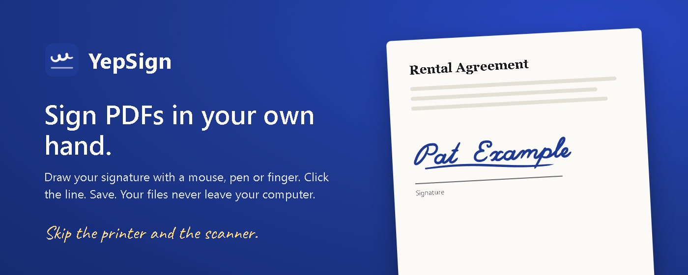
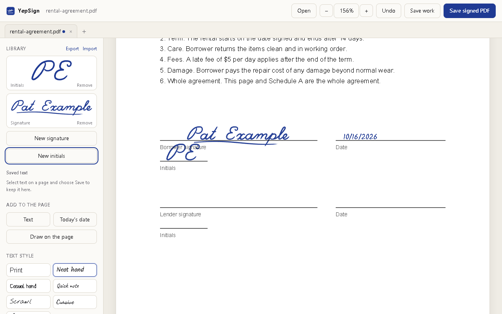
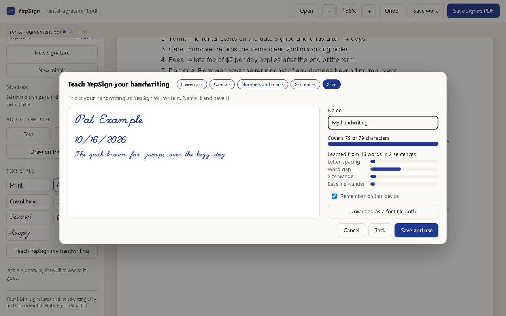

# YepSign



YepSign is a Chrome extension for signing PDFs without printing them. You draw your signature once with a mouse, a pen tablet or a finger, click the line it belongs on, and save a signed copy. The PDF never leaves your computer.

[Download the latest release](https://github.com/drknowhow/yepsign/releases/latest) · [Website](https://drknowhow.github.io/yepsign/) · [Privacy policy](docs/privacy.md) · Chrome Web Store listing coming soon



## What you can do with it

- Sign with ink that looks like ink. A pen tablet's pressure, or the speed of your mouse, changes the line width the way a ballpoint does. You choose the ink colour, the pen (ballpoint, fountain pen or felt marker) and the thickness. The ink is saved as vector paths, so it stays sharp at any zoom.
- Put the signature on the line. It sits on the line you click the same way it sat on the pad's line. You can also draw straight onto the page.
- Add dates, names and other text in print, in one of six handwriting styles, or in your own handwriting.
- Teach it your handwriting. You write each letter once on guide lines, then two sentences. YepSign writes typed text with your letters and with the spacing and unevenness it measured in your sentences, so a repeated letter never looks stamped. You can also download your handwriting as an `.otf` font for other apps.
- Keep several PDFs open as tabs.
- Save unfinished work as a `.yepsign` file and pick it up later. Everything you placed can still be moved, edited or removed.
- Keep signatures, initials and saved text in a library, and move the library to another computer with Export and Import.

YepSign handles rotated and cropped pages. A PDF that is protected against changes but allows printing gets a flattened copy: each page becomes an image with your signature on top.



## Your files stay on your computer

YepSign has no account, no server and no analytics. PDFs are opened and written inside the extension. Your signatures, saved text and handwriting are kept in Chrome's extension storage on your computer and are not synced. The only network requests YepSign makes fetch a PDF you asked it to open from a website. The [privacy policy](docs/privacy.md) has the details.

## Does a drawn signature count?

In the United States, the ESIGN Act and the state laws based on UETA generally give an electronic signature the same effect as one in ink, and many other countries have similar rules. Both sides have to agree to sign electronically, and there are exceptions, such as wills, some family-law and court documents, and certain notices. YepSign puts your handwriting on the document. It does not prove who signed and does not add a cryptographic digital signature. For a document that matters, check what the other side accepts. This is general information, not legal advice.

## Install

The Chrome Web Store listing is coming soon. Until then, install it from a release:

1. Download `yepsign-<version>.zip` from [Releases](https://github.com/drknowhow/yepsign/releases/latest) and unzip it.
2. Open `chrome://extensions`, turn on **Developer mode** and click **Load unpacked**.
3. Choose the unzipped folder.

To sign PDFs you open from your disk in Chrome, open YepSign's **Details** on `chrome://extensions` and turn on **Allow access to file URLs**.

## How to use it

- On a PDF open in Chrome, click the YepSign button (Alt+Shift+S). You can also right-click a link to a PDF and choose **Sign this PDF with YepSign**, or open YepSign and drop PDFs on it.
- **New signature** opens the drawing pad. Pick a saved signature and click the signing line. Drag to move it, use the round handle to resize it, press Delete to remove it and Ctrl+Z to undo.
- **Text** and **Today's date** add text on the line you click. Double-click text to edit it, or choose **Save** in its toolbar to keep it in your library.
- **Draw on the page** lets you sign directly on the document. **Done** turns the ink into a signature you can move.
- **Save signed PDF** (Ctrl+S) writes `<name>-signed.pdf`. **Save work** writes `<name>.yepsign`.

## Limits

- Saving rewrites the PDF, which invalidates any digital signatures already in it.
- Values typed into a form in Chrome's PDF viewer are not in the file YepSign reads. Save the filled form first, then open that file.
- Text in your own handwriting is drawn as ink, so it can't be selected or searched, just like real handwriting.
- Typed text covers Latin scripts; other characters become `?`.
- Open tabs are lost when the YepSign tab is closed. Use **Save work** for anything unfinished.
- A `.yepsign` file contains the original PDF and your signature strokes. Keep it as private as the signed document.

## Development

```bash
npm install
npm run vendor
npm test
```

`npm run vendor` copies pdf.js, pdf-lib, fontkit, opentype.js and perfect-freehand into `extension/vendor/` and downloads the handwriting fonts from [google/fonts](https://github.com/google/fonts). The tests and the font step need Python 3 with `pymupdf`, `numpy` and `fonttools`.

- `npm test` runs the unit tests. Several of them render the exported PDF with MuPDF and measure where the ink landed on rotated, cropped and offset pages.
- `python scripts/smoke.py` loads the extension into a throwaway Chromium profile with Playwright and signs the sample PDFs end to end.
- `npm run package` builds `dist/yepsign-<version>.zip` for the Chrome Web Store.
- `python scripts/store_assets.py` renders the store screenshots (`docs/img/`) and promo tiles (`store/`).

`lib/ink.js` turns pointer samples into ink outlines. `lib/export.js` writes them into the PDF with pdf-lib, using pdf.js's page transform, so rotation, crop boxes and UserUnit are handled in one place (`lib/geometry.js`). `lib/handfont.js` lays out text in a learned handwriting.

## License

MIT, see [LICENSE](LICENSE). Bundled libraries and fonts keep their own licenses, listed in [THIRD_PARTY_NOTICES.md](THIRD_PARTY_NOTICES.md).

The MIT license covers the code, not the YepSign name or logo. If you publish a fork to an extension store, please give it a different name and icon.
